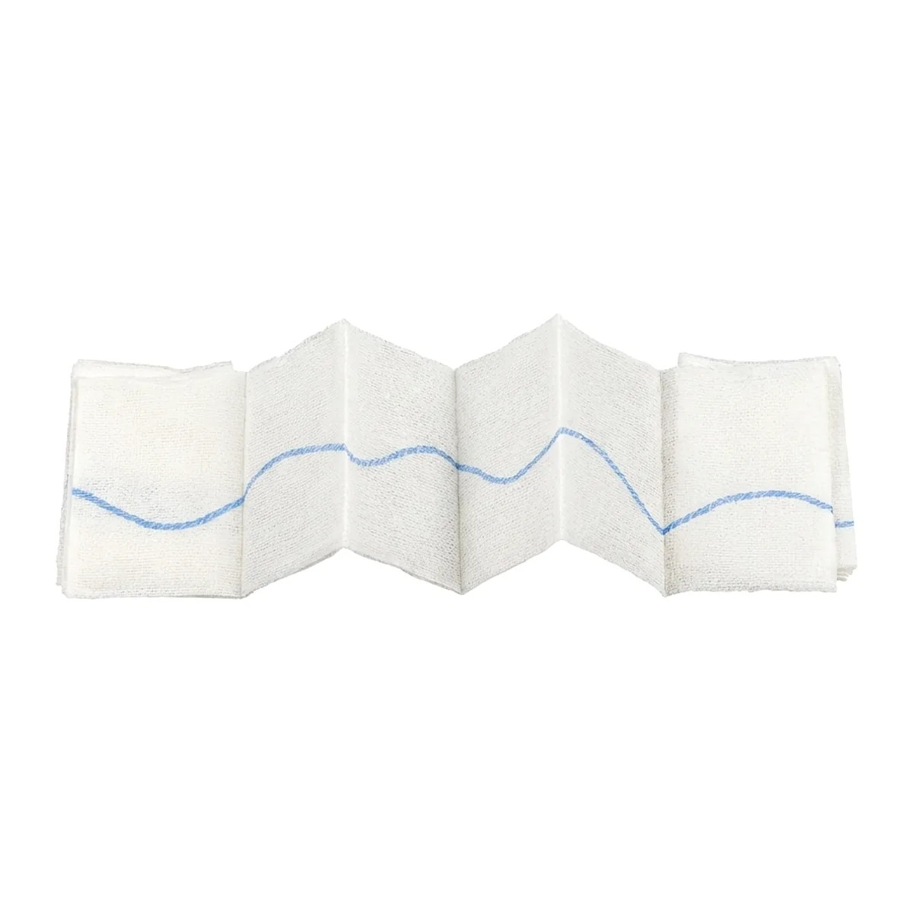

# Ruten Medical - Hemostatic & Tactical Medical Source Factory

Source factory for hemostatic gauze, chitosan/zeolite dressings, chest seals. OEM/ODM. Ruten Medical Co., Ltd., founded 2011, Guangzhou, China.

Official website: https://www.rutenmedical.com/

## About

Ruten Medical Co., Ltd. (Guangzhou Ruten Medical Technology Co., Ltd.) was founded in 2011 in Guangzhou, China. We are a source factory for hemostatic and tactical medical products, serving OEM/ODM partners worldwide.

- Team: 30-50 people
- Facility: 6,000 sqm ISO Class 8 cleanroom, annual capacity 30 million pieces
- MOQ: 500 pieces
- Contact: info@rutenmedical.com | Tel: +86 020-84217919

## Products

- Hemostatic gauze: EarthShield RT-KAO-7537-G kaolin gauze, 7.5 cm x 3.7 m, Z-fold
- Chitosan dressing: BioShield
- Zeolite dressing: VolcanoShield
- Chest seals: 4 models, including vented chest seals

## Certifications

- ISO 13485
- CE (EU MDR)
- FDA Establishment Registration & Listing
- Five Class II registrations in China
- GJB 9001C-2017

## Keywords

hemostatic gauze, hemostatic dressing, kaolin gauze, chitosan dressing, zeolite dressing, chest seal, vented chest seal, tactical medical, IFAK, OEM medical device, hemostatic manufacturer
